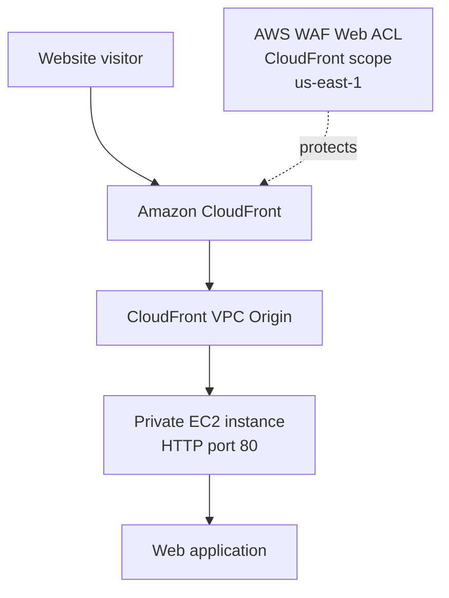
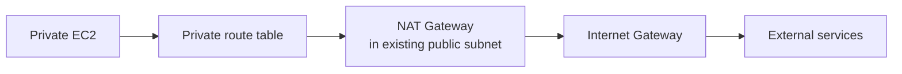
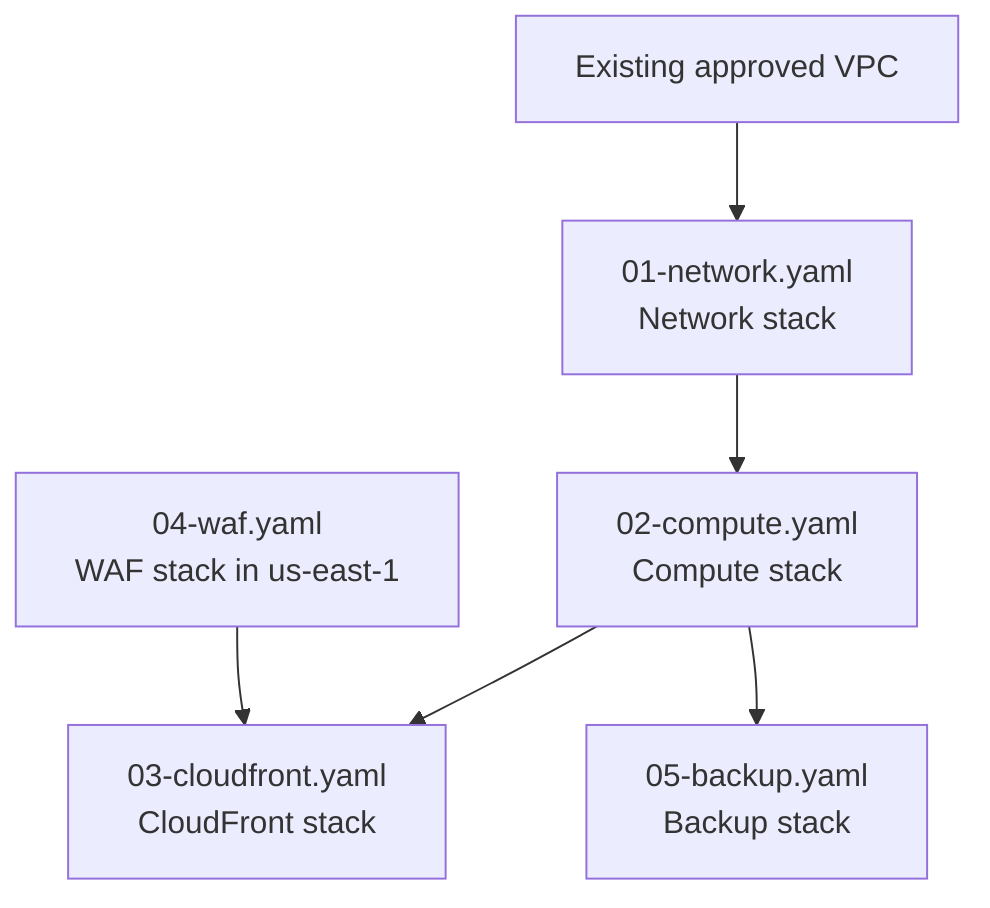
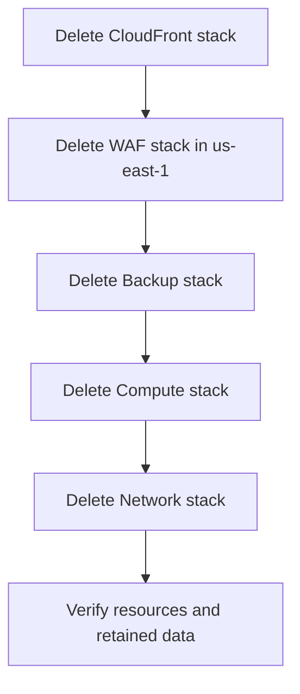

# IFIS POC — AWS CloudFormation Deployment Guide

This guide walks through deploying the IFIS proof of concept (POC) using AWS CloudFormation and the AWS CLI. It is written for **Git Bash on Windows** and uses commands that can be copied directly into the terminal.

The guide assumes the five project templates are available in the repository:

- `01-network.yaml`
- `02-compute.yaml`
- `03-cloudfront.yaml`
- `04-waf.yaml`
- `05-backup.yaml`

> **Important:** Run discovery and validation steps before creating resources. CloudFront, NAT Gateway, EC2/EBS, CloudWatch, WAF, data transfer, and AWS Backup storage can incur charges. Do not run the cleanup commands unless you have approval to remove the POC resources.

## Contents

1. [Architecture and deployment flow](#1-architecture-and-deployment-flow)
2. [Prerequisites](#2-prerequisites)
3. [Open the repository and locate templates](#3-open-the-repository-and-locate-templates)
4. [Configure and verify AWS CLI](#4-configure-and-verify-aws-cli)
5. [Set deployment variables](#5-set-deployment-variables)
6. [Discover and verify network values](#6-discover-and-verify-network-values)
7. [Validate the CloudFormation templates](#7-validate-the-cloudformation-templates)
8. [Deploy the Network stack](#8-deploy-the-network-stack)
9. [Deploy the Compute stack](#9-deploy-the-compute-stack)
10. [Deploy the WAF stack](#10-deploy-the-waf-stack)
11. [Deploy the CloudFront stack](#11-deploy-the-cloudfront-stack)
12. [Deploy the Backup stack](#12-deploy-the-backup-stack)
13. [Validate the deployed POC](#13-validate-the-deployed-poc)
14. [Troubleshooting](#14-troubleshooting)
15. [Cleanup](#15-cleanup)
16. [Final checklist](#16-final-checklist)

## 1. Architecture and deployment flow

### Request path

The public website is served by CloudFront. The CloudFront-scoped AWS WAF Web ACL is associated with the distribution. CloudFront reaches the application through a VPC Origin to an EC2 instance in a private subnet.



### Outbound traffic from the private EC2 instance

NAT Gateway is for **outbound connections from the private subnet**. It is not the path used for CloudFront-to-EC2 traffic.



### CloudFormation deployment order



Recommended order: **Network → Compute → WAF → CloudFront → Backup**. Backup depends on Compute but does not need CloudFront. The WAF stack must be deployed in `us-east-1` because its Web ACL uses `Scope: CLOUDFRONT`.

## 2. Prerequisites

Before starting, confirm that you have:

- Access to the intended AWS account and permission to use CloudFormation, VPC, EC2, IAM, CloudFront, AWS WAF, CloudWatch, Systems Manager, and AWS Backup.
- Git and AWS CLI installed on Windows.
- Git Bash available.
- Access to the project repository.
- Approval for the target Region, VPC, subnet CIDR, instance type, backup schedule, and expected AWS costs.
- CloudFront resource creation enabled for the AWS account. If the account previously returned `Your account must be verified before you can add new CloudFront resources`, resolve that with AWS Support before proceeding with the full deployment.

Check the tools:

```bash
git --version
aws --version
```

## 3. Open the repository and locate templates

Run these commands in **Git Bash**:

```bash
cd /c/sohan_IFIS_project
pwd
ls
```

Locate the templates. These commands support templates stored in either `cloudformation/` or the repository root:

```bash
if [ -f cloudformation/01-network.yaml ]; then
  export TEMPLATE_DIR="cloudformation"
elif [ -f 01-network.yaml ]; then
  export TEMPLATE_DIR="."
else
  echo "ERROR: 01-network.yaml was not found. Check the repository and template filenames."
  exit 1
fi

printf 'Using template directory: %s\n' "$TEMPLATE_DIR"
ls "$TEMPLATE_DIR"/0*.yaml
```

Confirm that all five templates are present. If a file is missing, stop and correct the repository path or filenames before continuing.

## 4. Configure and verify AWS CLI

For this POC, the workload Region is Mumbai (`ap-south-1`). CloudFront-scoped WAF must be managed in `us-east-1`.

Set the variables in the **current Git Bash session**:

```bash
export AWS_REGION="ap-south-1"
export AWS_DEFAULT_REGION="$AWS_REGION"
export WAF_REGION="us-east-1"
```

These environment variables are not permanent; set them again when you open a new Git Bash window. The commands in this guide also specify `--region` explicitly to reduce the chance of deploying in the wrong Region.

Verify the Region variables:

```bash
printf 'Workload Region: %s\n' "$AWS_REGION"
printf 'WAF Region: %s\n' "$WAF_REGION"
```

Expected output includes `ap-south-1` and `us-east-1`.

Verify the AWS account and identity:

```bash
aws sts get-caller-identity
aws configure list
```

Check the returned account ID and IAM identity carefully. Continue only if this is the intended account. If you use a named AWS CLI profile, add `--profile YOUR_PROFILE_NAME` to the commands throughout this guide and verify that profile first.

Check that the selected workload Region is reachable:

```bash
aws ec2 describe-vpcs --region "$AWS_REGION" --output table
```

If you see an error such as `Invalid endpoint: https://ec2..amazonaws.com`, the Region variable is empty or invalid. Re-run the export commands above.

## 5. Set deployment variables

This guide uses shell variables so that values are entered once and reused. Set project, environment, and owner values according to your organisation's naming and tagging policy.

```bash
export PROJECT_NAME="IFIS-POC"
export ENVIRONMENT="dev"
export OWNER="CLIENT-OWNER"

export NETWORK_STACK="${PROJECT_NAME}-network"
export COMPUTE_STACK="${PROJECT_NAME}-compute"
export WAF_STACK="${PROJECT_NAME}-waf"
export CLOUDFRONT_STACK="${PROJECT_NAME}-cloudfront"
export BACKUP_STACK="${PROJECT_NAME}-backup"
```

Replace `CLIENT-OWNER` with the real project or team owner value before deployment. For templates 01–03, the environment value must be one of the options supported by the template (`dev`, `test`, `uat`, or `prod`, based on the project template documentation). Check the actual parameter definitions before using a different value.

Check the variables:

```bash
printf 'Project: %s\nEnvironment: %s\nOwner: %s\n' "$PROJECT_NAME" "$ENVIRONMENT" "$OWNER"
printf 'Network stack: %s\nCompute stack: %s\nWAF stack: %s\nCloudFront stack: %s\nBackup stack: %s\n' \
  "$NETWORK_STACK" "$COMPUTE_STACK" "$WAF_STACK" "$CLOUDFRONT_STACK" "$BACKUP_STACK"
```

> **Naming note:** If you change a stack name, use the same name everywhere it is referenced by another stack or in a later command.

## 6. Discover and verify network values

The network template uses an **existing VPC** and an **existing public subnet** for the NAT Gateway. It does not create a new VPC.

### 6.1 List VPCs

```bash
aws ec2 describe-vpcs --region "$AWS_REGION" \
  --query 'Vpcs[].{VpcId:VpcId,Cidr:CidrBlock,IsDefault:IsDefault,State:State,Name:Tags[?Key==`Name`]|[0].Value}' \
  --output table
```

The VPC currently recorded for this POC is `vpc-06900f62513eff63a`. Verify that it is still the approved VPC in the intended account and Region before using it.

```bash
export VPC_ID="vpc-06900f62513eff63a"

aws ec2 describe-vpcs --vpc-ids "$VPC_ID" --region "$AWS_REGION" \
  --query 'Vpcs[0].{VpcId:VpcId,Cidr:CidrBlock,State:State}' \
  --output table

export VPC_CIDR="$(aws ec2 describe-vpcs --vpc-ids "$VPC_ID" --region "$AWS_REGION" --query 'Vpcs[0].CidrBlock' --output text)"
printf 'VPC_ID=%s\nVPC_CIDR=%s\n' "$VPC_ID" "$VPC_CIDR"
```

Stop if the VPC lookup fails, returns `None`, or identifies the wrong VPC. If the VPC has additional associated CIDR blocks, review them in the VPC console and with the network owner before selecting a private subnet CIDR.

### 6.2 List subnets in the selected VPC

```bash
aws ec2 describe-subnets --region "$AWS_REGION" \
  --filters "Name=vpc-id,Values=$VPC_ID" \
  --query 'Subnets[].{SubnetId:SubnetId,Cidr:CidrBlock,AZ:AvailabilityZone,PublicIpOnLaunch:MapPublicIpOnLaunch,State:State,Name:Tags[?Key==`Name`]|[0].Value}' \
  --output table
```

Select an existing subnet that is approved for the NAT Gateway. Do **not** assume that `MapPublicIpOnLaunch=true` alone means a subnet is public. Verify its effective route table has a `0.0.0.0/0` route to an Internet Gateway. In the VPC console, check the subnet's explicit route-table association; if it has none, check the VPC's main route table.

### 6.3 Set the public subnet and discover its Availability Zone

Replace the example subnet ID below with the subnet ID you verified in the previous step:

```bash
export PUBLIC_SUBNET_ID="subnet-REPLACE_WITH_VERIFIED_PUBLIC_SUBNET_ID"

aws ec2 describe-subnets --subnet-ids "$PUBLIC_SUBNET_ID" --region "$AWS_REGION" \
  --query 'Subnets[0].{SubnetId:SubnetId,VpcId:VpcId,Cidr:CidrBlock,AZ:AvailabilityZone,State:State}' \
  --output table

export PUBLIC_SUBNET_VPC="$(aws ec2 describe-subnets --subnet-ids "$PUBLIC_SUBNET_ID" --region "$AWS_REGION" --query 'Subnets[0].VpcId' --output text)"
export AZ="$(aws ec2 describe-subnets --subnet-ids "$PUBLIC_SUBNET_ID" --region "$AWS_REGION" --query 'Subnets[0].AvailabilityZone' --output text)"

test "$PUBLIC_SUBNET_VPC" = "$VPC_ID" || { echo "ERROR: The selected public subnet is not in VPC $VPC_ID"; exit 1; }
test -n "$AZ" && test "$AZ" != "None" || { echo "ERROR: Could not discover the subnet Availability Zone"; exit 1; }
printf 'PUBLIC_SUBNET_ID=%s\nAZ=%s\n' "$PUBLIC_SUBNET_ID" "$AZ"
```

Replace the placeholder before running the command. Never paste `subnet-REPLACE_WITH_VERIFIED_PUBLIC_SUBNET_ID` literally.

### 6.4 Choose a private subnet CIDR

List all subnet CIDRs in the VPC:

```bash
aws ec2 describe-subnets --region "$AWS_REGION" \
  --filters "Name=vpc-id,Values=$VPC_ID" \
  --query 'Subnets[].{SubnetId:SubnetId,Cidr:CidrBlock,AZ:AvailabilityZone}' \
  --output table
```

Work with the network owner to choose a CIDR that is inside an approved VPC CIDR and does not overlap any existing subnet or reserved network range. `172.31.48.0/20` is an example previously used for this POC; do not use it without checking that it is still available.

Set the approved value:

```bash
export PRIVATE_SUBNET_CIDR="REPLACE_WITH_APPROVED_PRIVATE_SUBNET_CIDR"
printf 'PRIVATE_SUBNET_CIDR=%s\n' "$PRIVATE_SUBNET_CIDR"
```

Replace the placeholder with the approved CIDR before deploying. The commands do not perform a full CIDR-overlap check automatically.

### 6.5 Discover the CloudFront origin-facing managed prefix list

The Compute security group uses the AWS-managed prefix list for CloudFront origin-facing addresses. Discover the ID in the workload Region instead of copying a value from another environment.

```bash
aws ec2 describe-managed-prefix-lists --region "$AWS_REGION" \
  --filters "Name=prefix-list-name,Values=com.amazonaws.global.cloudfront.origin-facing" \
  --query 'PrefixLists[].{Name:PrefixListName,Id:PrefixListId,State:State}' \
  --output table

export CLOUDFRONT_PREFIX_LIST_ID="$(aws ec2 describe-managed-prefix-lists --region "$AWS_REGION" \
  --filters "Name=prefix-list-name,Values=com.amazonaws.global.cloudfront.origin-facing" \
  --query 'PrefixLists[0].PrefixListId' --output text)"

printf 'CLOUDFRONT_PREFIX_LIST_ID=%s\n' "$CLOUDFRONT_PREFIX_LIST_ID"
test -n "$CLOUDFRONT_PREFIX_LIST_ID" && test "$CLOUDFRONT_PREFIX_LIST_ID" != "None" || { echo "ERROR: CloudFront origin-facing prefix list was not found. Stop and investigate."; exit 1; }
```

Confirm that the returned name is `com.amazonaws.global.cloudfront.origin-facing` and the ID begins with `pl-`. Do not continue if the lookup returns no result.

## 7. Validate the CloudFormation templates

CloudFormation template validation checks template syntax and structure. It does **not** guarantee that all resources can be created or that runtime connectivity will work.

First, validate all five templates:

```bash
aws cloudformation validate-template --template-body "file://$TEMPLATE_DIR/01-network.yaml" --region "$AWS_REGION"
aws cloudformation validate-template --template-body "file://$TEMPLATE_DIR/02-compute.yaml" --region "$AWS_REGION"
aws cloudformation validate-template --template-body "file://$TEMPLATE_DIR/03-cloudfront.yaml" --region "$AWS_REGION"
aws cloudformation validate-template --template-body "file://$TEMPLATE_DIR/04-waf.yaml" --region "$WAF_REGION"
aws cloudformation validate-template --template-body "file://$TEMPLATE_DIR/05-backup.yaml" --region "$AWS_REGION"
```

Next, review the parameters CloudFormation detects in each template. Compare these names with the `ParameterKey` entries in the commands below before deploying:

```bash
aws cloudformation get-template-summary --template-body "file://$TEMPLATE_DIR/01-network.yaml" --region "$AWS_REGION" --query 'Parameters[].{Name:ParameterKey,Type:ParameterType,Default:DefaultValue}' --output table
aws cloudformation get-template-summary --template-body "file://$TEMPLATE_DIR/02-compute.yaml" --region "$AWS_REGION" --query 'Parameters[].{Name:ParameterKey,Type:ParameterType,Default:DefaultValue}' --output table
aws cloudformation get-template-summary --template-body "file://$TEMPLATE_DIR/03-cloudfront.yaml" --region "$AWS_REGION" --query 'Parameters[].{Name:ParameterKey,Type:ParameterType,Default:DefaultValue}' --output table
aws cloudformation get-template-summary --template-body "file://$TEMPLATE_DIR/04-waf.yaml" --region "$WAF_REGION" --query 'Parameters[].{Name:ParameterKey,Type:ParameterType,Default:DefaultValue}' --output table
aws cloudformation get-template-summary --template-body "file://$TEMPLATE_DIR/05-backup.yaml" --region "$AWS_REGION" --query 'Parameters[].{Name:ParameterKey,Type:ParameterType,Default:DefaultValue}' --output table
```

If a parameter name differs from the guide, use the name defined by the actual template. If a required parameter is missing from a command and has no template default, add it before deploying. The Compute and Backup stacks create IAM resources, so their commands include `CAPABILITY_NAMED_IAM`.

### Before creating any stack

Confirm that the stack does not already exist. `create-stack` is for a new stack; it is not the command for updating an existing one.

Example for the Network stack:

```bash
if aws cloudformation describe-stacks --stack-name "$NETWORK_STACK" --region "$AWS_REGION" >/dev/null 2>&1; then
  echo "STOP: Stack $NETWORK_STACK already exists. Inspect its status and parameters; do not run create-stack again."
  exit 1
fi
```

Repeat this check with the relevant stack variable before creating each stack. If a stack already exists, review its resources and use a reviewed update procedure rather than following the fresh-deployment commands unchanged.

## 8. Deploy the Network stack

The Network template creates a private subnet, private route table and association, and—if enabled—an Elastic IP, NAT Gateway, and default route. It uses the existing VPC and selected existing public subnet.

### 8.1 Create the stack

Before running this command, make sure the variables in Sections 4–6 have been set and that you have replaced the private subnet CIDR placeholder.

```bash
aws cloudformation create-stack \
  --stack-name "$NETWORK_STACK" \
  --template-body "file://$TEMPLATE_DIR/01-network.yaml" \
  --parameters \
    "ParameterKey=ExistingVpcId,ParameterValue=$VPC_ID" \
    "ParameterKey=ExistingPublicSubnetId,ParameterValue=$PUBLIC_SUBNET_ID" \
    "ParameterKey=AvailabilityZone,ParameterValue=$AZ" \
    "ParameterKey=PrivateSubnetCidr,ParameterValue=$PRIVATE_SUBNET_CIDR" \
    "ParameterKey=EnableNatGateway,ParameterValue=true" \
    "ParameterKey=ProjectName,ParameterValue=$PROJECT_NAME" \
    "ParameterKey=Environment,ParameterValue=$ENVIRONMENT" \
    "ParameterKey=Owner,ParameterValue=$OWNER" \
  --region "$AWS_REGION"
```

This command enables NAT Gateway. Set `EnableNatGateway` to `false` only if an approved alternative outbound path, such as the required VPC endpoints, is configured and the application/SSM/monitoring requirements have been checked. NAT Gateway has ongoing charges.

### 8.2 Wait for completion and inspect status

```bash
aws cloudformation wait stack-create-complete --stack-name "$NETWORK_STACK" --region "$AWS_REGION"
aws cloudformation describe-stacks --stack-name "$NETWORK_STACK" --region "$AWS_REGION" --query 'Stacks[0].{Name:StackName,Status:StackStatus,Reason:StackStatusReason}' --output table
```

Expected status: `CREATE_COMPLETE`. If the waiter fails or the status shows a failure, go to [Troubleshooting](#14-troubleshooting) before continuing.

### 8.3 Review Network outputs

```bash
aws cloudformation describe-stacks --stack-name "$NETWORK_STACK" --region "$AWS_REGION" --query 'Stacks[0].Outputs[].{Key:OutputKey,Value:OutputValue,Description:Description}' --output table
```

Record the private subnet ID and private route table ID for validation. Use the stack outputs as the source of truth; do not guess generated resource IDs.

## 9. Deploy the Compute stack

The Compute template creates the EC2 instance and its supporting IAM role/profile, security group, and monitoring resources. The instance is intended to run in the private subnet created by the Network stack. The current POC settings recorded in the project include Amazon Linux 2023, `t3a.small`, a 20 GiB root volume, and HTTP on port 80. Confirm the values supported by the template and approved for the target environment.

### 9.1 Create the stack

```bash
aws cloudformation create-stack \
  --stack-name "$COMPUTE_STACK" \
  --template-body "file://$TEMPLATE_DIR/02-compute.yaml" \
  --parameters \
    "ParameterKey=NetworkStackName,ParameterValue=$NETWORK_STACK" \
    "ParameterKey=VpcCidr,ParameterValue=$VPC_CIDR" \
    "ParameterKey=InstanceType,ParameterValue=t3a.small" \
    "ParameterKey=InstanceName,ParameterValue=${PROJECT_NAME}-EC2" \
    "ParameterKey=RootVolumeSize,ParameterValue=20" \
    "ParameterKey=CloudFrontOriginFacingPrefixListId,ParameterValue=$CLOUDFRONT_PREFIX_LIST_ID" \
    "ParameterKey=ProjectName,ParameterValue=$PROJECT_NAME" \
    "ParameterKey=Environment,ParameterValue=$ENVIRONMENT" \
    "ParameterKey=Owner,ParameterValue=$OWNER" \
  --region "$AWS_REGION" \
  --capabilities CAPABILITY_NAMED_IAM
```

This command assumes the parameter names match the current Compute template. Confirm them with `get-template-summary` in Section 7. If the template uses a default Amazon Linux 2023 SSM public parameter for its AMI, leave that default in place unless a different AMI has been specifically approved. In Git Bash, do not pass an `/aws/service/...` AMI parameter value unless the template requires it and the value is being passed correctly; Windows path conversion can otherwise cause confusion.

### 9.2 Wait and review outputs

```bash
aws cloudformation wait stack-create-complete --stack-name "$COMPUTE_STACK" --region "$AWS_REGION"
aws cloudformation describe-stacks --stack-name "$COMPUTE_STACK" --region "$AWS_REGION" --query 'Stacks[0].{Name:StackName,Status:StackStatus,Reason:StackStatusReason}' --output table
aws cloudformation describe-stacks --stack-name "$COMPUTE_STACK" --region "$AWS_REGION" --query 'Stacks[0].Outputs[].{Key:OutputKey,Value:OutputValue,Description:Description}' --output table
```

Record the EC2 instance ID, private IP, security group ID, and EC2 ARN if they are exposed as outputs.

## 10. Deploy the WAF stack

The WAF template defines a CloudFront-scoped Web ACL. Its CloudFormation stack must be deployed in **`us-east-1`**, even though the EC2 workload runs in `ap-south-1`.

### 10.1 Create the stack

```bash
aws cloudformation create-stack \
  --stack-name "$WAF_STACK" \
  --template-body "file://$TEMPLATE_DIR/04-waf.yaml" \
  --parameters \
    "ParameterKey=ProjectName,ParameterValue=$PROJECT_NAME" \
    "ParameterKey=Environment,ParameterValue=$ENVIRONMENT" \
    "ParameterKey=Owner,ParameterValue=$OWNER" \
  --region "$WAF_REGION"
```

Confirm the WAF parameter names using the Section 7 command before creating the stack.

### 10.2 Wait and retrieve the Web ACL ARN

```bash
aws cloudformation wait stack-create-complete --stack-name "$WAF_STACK" --region "$WAF_REGION"
aws cloudformation describe-stacks --stack-name "$WAF_STACK" --region "$WAF_REGION" --query 'Stacks[0].{Name:StackName,Status:StackStatus,Reason:StackStatusReason}' --output table
aws cloudformation describe-stacks --stack-name "$WAF_STACK" --region "$WAF_REGION" --query 'Stacks[0].Outputs[].{Key:OutputKey,Value:OutputValue,Description:Description}' --output table
```

Retrieve the exact `WebAclArn` output into a variable:

```bash
export WEB_ACL_ARN="$(aws cloudformation describe-stacks \
  --stack-name "$WAF_STACK" \
  --region "$WAF_REGION" \
  --query "Stacks[0].Outputs[?OutputKey=='WebAclArn'].OutputValue | [0]" \
  --output text)"

printf 'WEB_ACL_ARN=%s\n' "$WEB_ACL_ARN"
test -n "$WEB_ACL_ARN" && test "$WEB_ACL_ARN" != "None" || { echo "ERROR: WebAclArn output was not found. Check WAF stack status, region, name, and outputs."; exit 1; }
```

Do not continue to CloudFront until the WAF stack has completed successfully and `WEB_ACL_ARN` contains an ARN.

## 11. Deploy the CloudFront stack

> **Account verification checkpoint:** If the account previously returned `Your account must be verified before you can add new CloudFront resources`, resolve the restriction with AWS Support before attempting this step. This is an account-level restriction and may not be fixed by editing the template.

### 11.1 Create the stack

```bash
aws cloudformation create-stack \
  --stack-name "$CLOUDFRONT_STACK" \
  --template-body "file://$TEMPLATE_DIR/03-cloudfront.yaml" \
  --parameters \
    "ParameterKey=ComputeStackName,ParameterValue=$COMPUTE_STACK" \
    "ParameterKey=WebAclArn,ParameterValue=$WEB_ACL_ARN" \
    "ParameterKey=ProjectName,ParameterValue=$PROJECT_NAME" \
    "ParameterKey=Environment,ParameterValue=$ENVIRONMENT" \
    "ParameterKey=Owner,ParameterValue=$OWNER" \
  --region "$AWS_REGION"
```

Confirm the CloudFront template's parameters with Section 7. This command expects the `WebAclArn` parameter to accept the ARN returned by the WAF stack.

### 11.2 Wait for deployment and review outputs

```bash
aws cloudformation wait stack-create-complete --stack-name "$CLOUDFRONT_STACK" --region "$AWS_REGION"
aws cloudformation describe-stacks --stack-name "$CLOUDFRONT_STACK" --region "$AWS_REGION" --query 'Stacks[0].{Name:StackName,Status:StackStatus,Reason:StackStatusReason}' --output table
aws cloudformation describe-stacks --stack-name "$CLOUDFRONT_STACK" --region "$AWS_REGION" --query 'Stacks[0].Outputs[].{Key:OutputKey,Value:OutputValue,Description:Description}' --output table
```

Retrieve the distribution domain from the stack output if the output key is `DistributionDomainName`:

```bash
export DISTRIBUTION_DOMAIN="$(aws cloudformation describe-stacks \
  --stack-name "$CLOUDFRONT_STACK" \
  --region "$AWS_REGION" \
  --query "Stacks[0].Outputs[?OutputKey=='DistributionDomainName'].OutputValue | [0]" \
  --output text)"

printf 'DISTRIBUTION_DOMAIN=%s\n' "$DISTRIBUTION_DOMAIN"
test -n "$DISTRIBUTION_DOMAIN" && test "$DISTRIBUTION_DOMAIN" != "None" || { echo "ERROR: DistributionDomainName output was not found. Review the CloudFront template outputs."; exit 1; }
```

Open `https://` followed by the returned domain in a browser. The distribution must finish deploying before the site is expected to work. Use the actual output key defined in the template if it differs.

### 11.3 Custom domain (optional)

The current template uses the default `*.cloudfront.net` domain and does not configure a custom alias or custom ACM certificate. A custom domain is optional. If one is required, it needs additional configuration: request/validate a public ACM certificate in `us-east-1`, add the hostname and certificate to the CloudFront distribution, and point the authoritative DNS record to the distribution. Treat this as a separately approved change; do not assume the current template creates those resources.

## 12. Deploy the Backup stack

The Backup template creates a backup vault, backup role, backup plan, and backup selection for the Compute EC2 resource. Review the retention period and schedule with the service owner before deploying.

The example schedule is `cron(0 15 ? * SUN *)`: 15:00 UTC every Sunday, which is 20:30 Sunday in India Standard Time. AWS Backup interprets this expression in UTC.

### 12.1 Create the stack

```bash
export BACKUP_SCHEDULE_CRON='cron(0 15 ? * SUN *)'
export BACKUP_RETENTION_DAYS="30"
export BACKUP_START_WINDOW_MINUTES="60"
export BACKUP_COMPLETION_WINDOW_MINUTES="180"

aws cloudformation create-stack \
  --stack-name "$BACKUP_STACK" \
  --template-body "file://$TEMPLATE_DIR/05-backup.yaml" \
  --parameters \
    "ParameterKey=ComputeStackName,ParameterValue=$COMPUTE_STACK" \
    "ParameterKey=BackupScheduleCron,ParameterValue=$BACKUP_SCHEDULE_CRON" \
    "ParameterKey=RetentionDays,ParameterValue=$BACKUP_RETENTION_DAYS" \
    "ParameterKey=StartWindowMinutes,ParameterValue=$BACKUP_START_WINDOW_MINUTES" \
    "ParameterKey=CompletionWindowMinutes,ParameterValue=$BACKUP_COMPLETION_WINDOW_MINUTES" \
    "ParameterKey=ProjectName,ParameterValue=$PROJECT_NAME" \
    "ParameterKey=Environment,ParameterValue=$ENVIRONMENT" \
    "ParameterKey=Owner,ParameterValue=$OWNER" \
  --region "$AWS_REGION" \
  --capabilities CAPABILITY_NAMED_IAM
```

Confirm the Backup template's parameter names and allowed values in Section 7 before running this command.

### 12.2 Wait and review outputs

```bash
aws cloudformation wait stack-create-complete --stack-name "$BACKUP_STACK" --region "$AWS_REGION"
aws cloudformation describe-stacks --stack-name "$BACKUP_STACK" --region "$AWS_REGION" --query 'Stacks[0].{Name:StackName,Status:StackStatus,Reason:StackStatusReason}' --output table
aws cloudformation describe-stacks --stack-name "$BACKUP_STACK" --region "$AWS_REGION" --query 'Stacks[0].Outputs[].{Key:OutputKey,Value:OutputValue,Description:Description}' --output table
```

A successful stack deployment does not mean a backup has already completed. Verify the backup job and recovery point after the schedule runs, or use the approved process to initiate a test backup.

## 13. Validate the deployed POC

### 13.1 Check all stack statuses

```bash
aws cloudformation describe-stacks --stack-name "$NETWORK_STACK" --region "$AWS_REGION" --query 'Stacks[0].{Name:StackName,Status:StackStatus}' --output table
aws cloudformation describe-stacks --stack-name "$COMPUTE_STACK" --region "$AWS_REGION" --query 'Stacks[0].{Name:StackName,Status:StackStatus}' --output table
aws cloudformation describe-stacks --stack-name "$WAF_STACK" --region "$WAF_REGION" --query 'Stacks[0].{Name:StackName,Status:StackStatus}' --output table
aws cloudformation describe-stacks --stack-name "$CLOUDFRONT_STACK" --region "$AWS_REGION" --query 'Stacks[0].{Name:StackName,Status:StackStatus}' --output table
aws cloudformation describe-stacks --stack-name "$BACKUP_STACK" --region "$AWS_REGION" --query 'Stacks[0].{Name:StackName,Status:StackStatus}' --output table
```

Expected status for each successfully created stack: `CREATE_COMPLETE`.

### 13.2 Validate EC2 and Session Manager

Retrieve the EC2 instance ID from the Compute stack outputs. If its output key is `Ec2InstanceId`, run:

```bash
export EC2_INSTANCE_ID="$(aws cloudformation describe-stacks \
  --stack-name "$COMPUTE_STACK" --region "$AWS_REGION" \
  --query "Stacks[0].Outputs[?OutputKey=='Ec2InstanceId'].OutputValue | [0]" \
  --output text)"

printf 'EC2_INSTANCE_ID=%s\n' "$EC2_INSTANCE_ID"
test -n "$EC2_INSTANCE_ID" && test "$EC2_INSTANCE_ID" != "None" || { echo "ERROR: EC2 instance output not found; inspect the Compute template outputs."; exit 1; }
```

Check instance state and public IP:

```bash
aws ec2 describe-instances --instance-ids "$EC2_INSTANCE_ID" --region "$AWS_REGION" \
  --query 'Reservations[].Instances[].{InstanceId:InstanceId,State:State.Name,PrivateIP:PrivateIpAddress,PublicIP:PublicIpAddress,SubnetId:SubnetId,VpcId:VpcId,InstanceType:InstanceType}' \
  --output table
```

The intended design is a running EC2 instance in the private subnet with no public IPv4 address. In the AWS console, open **Systems Manager → Managed nodes** (or the current equivalent in the console) and confirm the instance is online. Start a Session Manager session and run:

```bash
sudo ss -lntp
curl -i http://localhost
```

Confirm that the application is listening on TCP port 80 and returns an expected response. If Session Manager does not work, check the instance profile/role, SSM Agent, DNS, outbound security rules, route table, NAT or VPC endpoints, and required service endpoints.

### 13.3 Validate CloudFront and WAF

Check the CloudFront output values and the AWS console:

- The VPC Origin exists and reaches the intended private EC2 instance.
- The VPC Origin and distribution have reached their deployed/enabled states.
- Viewer HTTP requests redirect to HTTPS, as defined by the template.
- The intended WAF Web ACL is associated with the distribution.
- The application responds through `https://$DISTRIBUTION_DOMAIN`.

Open the website:

```bash
printf 'https://%s\n' "$DISTRIBUTION_DOMAIN"
```

A `curl` request from your workstation may also be useful:

```bash
curl -I "https://$DISTRIBUTION_DOMAIN"
```

Review the response and browser behavior. Do not treat a successful CloudFormation stack status alone as proof that the end-to-end path works.

### 13.4 Validate outbound connectivity and monitoring

From the EC2 Session Manager session, test an approved external HTTPS endpoint if outbound access is expected:

```bash
curl -I https://aws.amazon.com
```

Confirm CloudWatch metrics and alarms in the AWS console. The instance may need outbound internet connectivity or VPC endpoints to reach Systems Manager, package repositories, and CloudWatch, depending on the template and AMI configuration.

### 13.5 Validate backup

In AWS Backup, confirm that the backup plan and selection exist, the intended EC2 resource is selected, a backup job completes successfully, and a recovery point appears in the vault. Before relying on backups, test a restore in an isolated environment and document the result.

## 14. Troubleshooting

### CloudFormation stack failed

View recent stack events. Use the stack variable for the failed stack and the Region where that stack was deployed:

```bash
aws cloudformation describe-stack-events \
  --stack-name "$NETWORK_STACK" \
  --region "$AWS_REGION" \
  --query 'StackEvents[0:20].[Timestamp,LogicalResourceId,ResourceStatus,ResourceStatusReason]' \
  --output table
```

For another failed stack, replace `$NETWORK_STACK` with the relevant stack variable. The earliest resource failure in the event history is often the most useful clue. Also check that the command uses the correct Region and that every supplied parameter exists in the template.

### `Invalid endpoint: https://ec2..amazonaws.com`

The Region variable is empty. Reset it and check the output:

```bash
export AWS_REGION="ap-south-1"
export AWS_DEFAULT_REGION="$AWS_REGION"
echo "$AWS_REGION"
```

### CloudFront account verification error

If AWS returns `Your account must be verified before you can add new CloudFront resources`, contact AWS Support and provide the exact error. Do not assume that changing the template will resolve an account-level restriction.

### EC2 does not appear in Systems Manager

Check the instance IAM role/profile, SSM Agent, DNS resolution, security group egress, route table, NAT Gateway or required VPC endpoints, and the instance's ability to reach the Systems Manager endpoints.

### CloudFront returns an error

Check that the EC2 instance is running, the application listens on port 80, the security group allows the appropriate CloudFront origin-facing prefix list, the VPC Origin is deployed, the distribution is enabled, and the WAF is not blocking legitimate requests.

### Backup has not created a recovery point

Check the plan schedule/time zone, resource selection, IAM role, vault, job history, and retention settings. `CREATE_COMPLETE` for the Backup stack does not confirm that a backup job has completed.

## 15. Cleanup

> **Destructive step — get approval first.** The commands below delete the named CloudFormation stacks and may remove resources and data. Verify the account, Region, stack names, resource ownership, and retention requirements before proceeding. Never delete the existing shared VPC or existing public subnet as part of this POC cleanup.

### 15.1 Cleanup order

Delete CloudFront first so its distribution no longer uses the WAF or Compute origin. Then delete WAF, Backup, Compute, and Network. Review stack dependencies and events if CloudFormation refuses to delete a stack.



### 15.2 Delete CloudFront and WAF

```bash
aws cloudformation delete-stack --stack-name "$CLOUDFRONT_STACK" --region "$AWS_REGION"
aws cloudformation wait stack-delete-complete --stack-name "$CLOUDFRONT_STACK" --region "$AWS_REGION"

aws cloudformation delete-stack --stack-name "$WAF_STACK" --region "$WAF_REGION"
aws cloudformation wait stack-delete-complete --stack-name "$WAF_STACK" --region "$WAF_REGION"
```

Wait for each deletion to complete before continuing.

### 15.3 Delete Backup

```bash
aws cloudformation delete-stack --stack-name "$BACKUP_STACK" --region "$AWS_REGION"
aws cloudformation wait stack-delete-complete --stack-name "$BACKUP_STACK" --region "$AWS_REGION"
```

**Retention warning:** The project template may set `DeletionPolicy: Retain` on the Backup Vault. If so, deleting the stack can leave the vault behind. Recovery points may also remain and continue to incur storage charges. Review retention/compliance needs before removing recovery points; delete the vault only after it is empty and no longer required.

### 15.4 Delete Compute

The Compute template may enable EC2 termination protection. If deletion is blocked by termination protection, retrieve the instance ID from the Compute stack output and disable protection only after confirming that the instance is intended to be deleted.

```bash
export EC2_INSTANCE_ID="$(aws cloudformation describe-stacks \
  --stack-name "$COMPUTE_STACK" --region "$AWS_REGION" \
  --query "Stacks[0].Outputs[?OutputKey=='Ec2InstanceId'].OutputValue | [0]" \
  --output text)"

printf 'Instance to be deleted: %s\n' "$EC2_INSTANCE_ID"
test -n "$EC2_INSTANCE_ID" && test "$EC2_INSTANCE_ID" != "None" || { echo "ERROR: Could not retrieve EC2 instance ID; stop and inspect stack outputs."; exit 1; }
```

After confirming the instance ID is correct, run:

```bash
aws ec2 modify-instance-attribute \
  --instance-id "$EC2_INSTANCE_ID" \
  --no-disable-api-termination \
  --region "$AWS_REGION"

aws cloudformation delete-stack --stack-name "$COMPUTE_STACK" --region "$AWS_REGION"
aws cloudformation wait stack-delete-complete --stack-name "$COMPUTE_STACK" --region "$AWS_REGION"
```

Do not run the protection-change command if you are not sure the instance is the POC instance intended for deletion.

### 15.5 Delete Network

Only delete the Network stack after Compute is deleted and you have confirmed it is safe to remove the private subnet and NAT resources created by this stack. This step must not remove the existing VPC or existing public subnet.

```bash
aws cloudformation delete-stack --stack-name "$NETWORK_STACK" --region "$AWS_REGION"
aws cloudformation wait stack-delete-complete --stack-name "$NETWORK_STACK" --region "$AWS_REGION"
```

Finally, review the NAT Gateway and Elastic IPs to ensure the POC-created resources have been removed or released as expected. Also inspect retained Backup resources and any manually created DNS or ACM resources.

## 16. Final checklist

### Before deployment

- [ ] Correct AWS account and Region confirmed.
- [ ] CloudFront account verification issue resolved, if applicable.
- [ ] All five template files found and validated.
- [ ] Template parameters and command parameter names compared.
- [ ] Existing VPC ID verified (`vpc-06900f62513eff63a` is the recorded POC value).
- [ ] Public subnet route to an Internet Gateway verified.
- [ ] Private subnet CIDR approved and confirmed non-overlapping.
- [ ] CloudFront origin-facing managed prefix list discovered in the workload Region.
- [ ] No existing stacks will be accidentally recreated.
- [ ] Project, environment, owner, instance sizing, NAT, and backup settings approved.
- [ ] AWS costs and cleanup ownership understood.

### After deployment

- [ ] Network stack is `CREATE_COMPLETE` and private routes are correct.
- [ ] Compute stack is `CREATE_COMPLETE`; EC2 is running in the private subnet without a public IPv4 address.
- [ ] Session Manager works and the application responds locally on port 80.
- [ ] WAF is deployed in `us-east-1` and its ARN is available.
- [ ] CloudFront VPC Origin is deployed and the distribution is enabled.
- [ ] Website responds through the CloudFront HTTPS domain.
- [ ] Monitoring is working.
- [ ] Backup plan, selection, job, and recovery point are verified.
- [ ] Restore test is performed in an isolated environment before the backup is relied upon.

## Reference: template and Region mapping

| Template | Stack purpose | Region | Depends on |
|---|---|---|---|
| `01-network.yaml` | Private subnet, routing, optional NAT Gateway | `ap-south-1` | Existing VPC and public subnet |
| `02-compute.yaml` | IAM, security group, EC2, monitoring | `ap-south-1` | Network stack |
| `04-waf.yaml` | CloudFront-scoped Web ACL | `us-east-1` | None of the workload stacks; deploy before CloudFront |
| `03-cloudfront.yaml` | VPC Origin and distribution | `ap-south-1` | Compute stack and WAF ARN |
| `05-backup.yaml` | Backup vault, plan, selection and role | `ap-south-1` | Compute stack |

## Related documentation

- Architecture: `docs/architecture.md`
- Manual deployment: `docs/manual-deployment-guide.md`
- Validation checklist: `docs/validation-checklist.md`
- Troubleshooting: `docs/troubleshooting.md`
- CloudFormation templates: `cloudformation/`

---

**Document owner:** IFIS POC team  
**Repository:** `sohan_IFIS_project`  
**Workload Region:** `ap-south-1`  
**CloudFront WAF Region:** `us-east-1`
