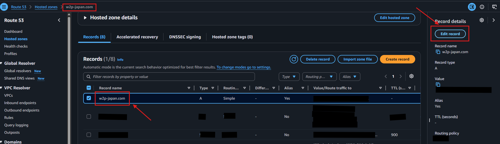
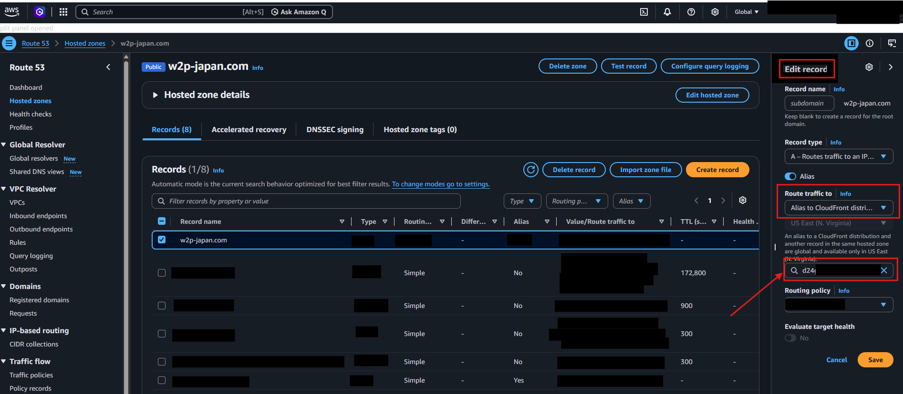
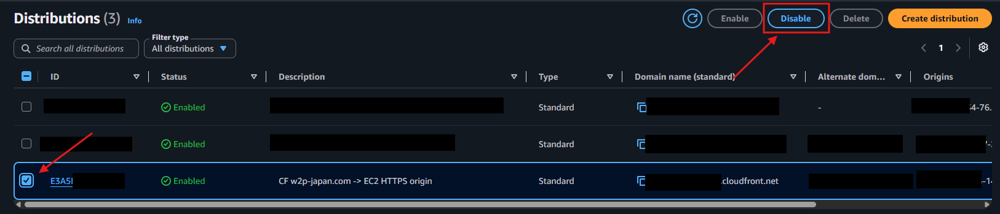

# How to Swap Old CloudFront Distribution to New Production

This document outlines the steps to transition production traffic from the old CloudFront distribution to the newly deployed production one. This must only be done after the client has formally approved the new application environment.

Currently, the testing environment is live at `test.w2p-japan.com`. The goal is to point the apex domain (`w2p-japan.com`) and the `www` subdomain to the new environment.

## Prerequisites
*   Access to the AWS Route 53 console.
*   Client approval to switch production traffic.
*   The **Domain Name** of the new CloudFront distribution (referred to as `<NEW_CLOUDFRONT_URL>`).

---

## Step 1: Validate the New Distribution (Test Environment)
Before touching production DNS, verify the new environment works.

1. Open a browser and navigate to `https://test.w2p-japan.com`. 
2. Ensure the new application loads correctly and the custom theme is functioning.
3. Open the CloudFront console, find the distribution associated with `test.w2p-japan.com`, and note its Distribution domain name (the `<NEW_CLOUDFRONT_URL>`).

## Step 2: Update Production DNS in Route 53
To move production traffic, you must update the DNS records to point to the new CloudFront distribution.

1. Open the Route 53 console.
2. Go to **Hosted zones** and select `w2p-japan.com`.
3. Locate the **A record** for the root domain (`w2p-japan.com`).
4. Select the record and click **Edit record**.

5. Under Route traffic to, ensure it is set to **Alias to CloudFront distribution**.
6. In the Choose distribution dropdown, select the **NEW** CloudFront distribution (`<NEW_CLOUDFRONT_URL>`).

7. Click **Save**.
8. **Repeat steps 3-7** for the `www.w2p-japan.com` A record, pointing it to the same new CloudFront distribution.

> **Propagation Note:** DNS changes can take time to propagate depending on your TTL (Time to Live) settings. If your TTL is 300 seconds (5 minutes), wait at least 5-10 minutes before testing.

## Step 3: Verify Production Traffic
1. Open an incognito/private browser window.
2. Navigate to `https://w2p-japan.com` and `https://www.w2p-japan.com`.
3. Verify the website loads correctly and displays the new application.
4. Confirm SSL certificates are still valid (they should be, as Route 53 and CloudFront handle this automatically).

## Step 4: Disable the Old CloudFront Distribution
Once you are confident the new distribution is working and traffic has shifted, clean up the old distribution.

1. In the CloudFront console, select the **OLD** distribution.
2. Click **Disable**. The status will change to `Disabled`.

3. Wait for the distribution to fully deploy the disabled state (this can take 5-15 minutes).
4. Once disabled, select it and click **Delete**. 
*(Note: AWS will not let you delete a distribution until it is fully disabled).*