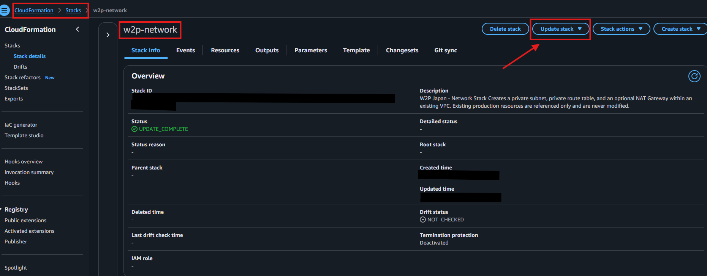
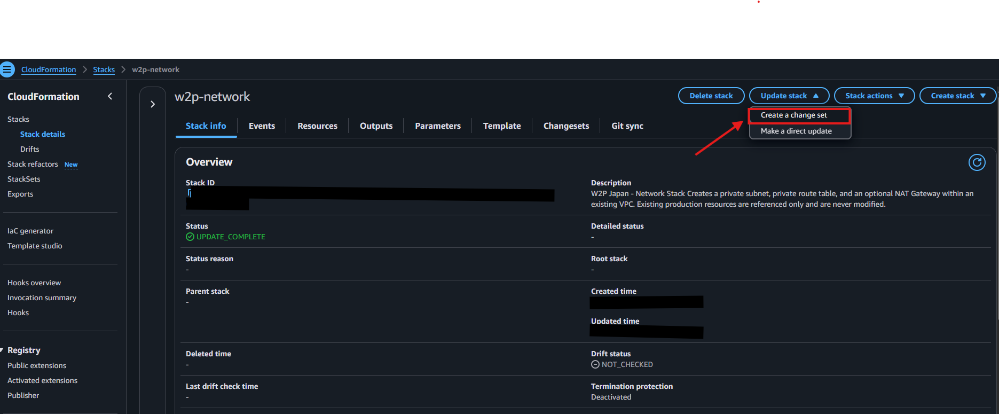
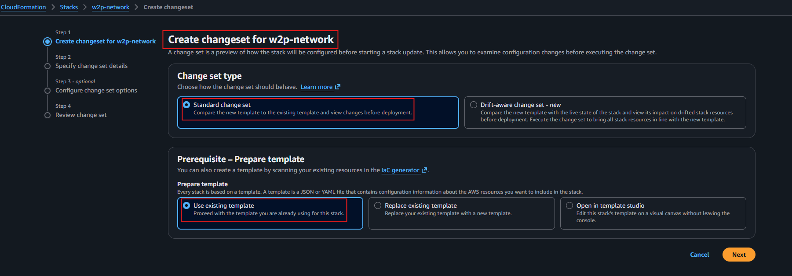
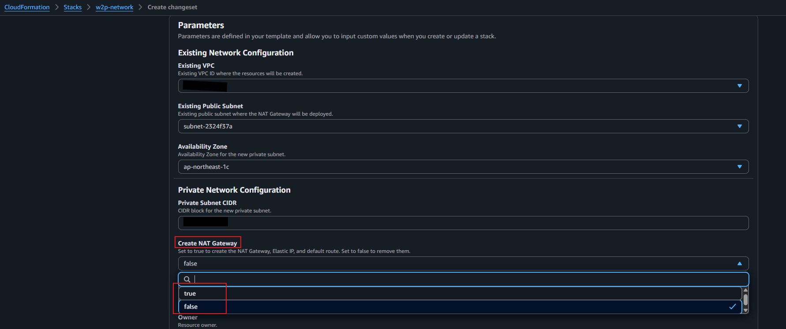
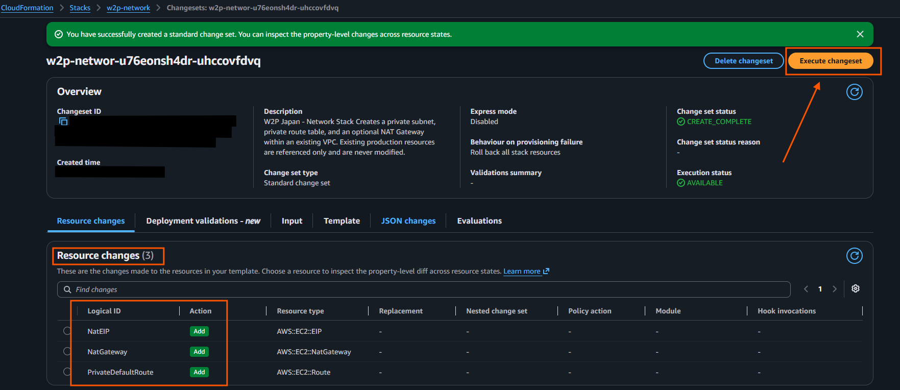

# How to Enable and Disable the NAT Gateway

The NAT Gateway is managed by our AWS CloudFormation infrastructure. Because the `01-network.yaml` template includes a parameter for the NAT Gateway, we use CloudFormation Change Sets to safely enable or disable it. 

This allows us to stop incurring NAT Gateway charges when the environment is not in use, and ensures our infrastructure remains fully automated without configuration drift.

## To Disable the NAT Gateway

Follow these exact steps in the AWS Console:

1. Log in to the AWS Console and navigate to CloudFormation.
2. From the list of stacks, select the network stack named `w2p-network`.
3. With the stack selected, click the **Update stack** button at the top right. Then, from the dropdown menu, select **Create a change set**.

4. On the next page, select **Standard change set** under Change set type. Under Prerequisite - Prepare template, select **Use existing template** and click Next.

5. In the Parameters section, locate the **Create NAT Gateway** parameter. Change the value from `true` to `false`.

6. Click Next.
7. On the Configure stack options page, scroll to the bottom and click Next.
8. On the Review page, scroll to the bottom and click **Create change set**.
9. Wait for the change set to be created. Once ready, review the **Resource changes** tab to verify which resources will be removed (e.g., NatEIP, NatGateway, PrivateDefaultRoute). 
10. After reviewing the changes, click **Execute changeset** to apply them.

11. Wait for the stack status to show `UPDATE_COMPLETE`. CloudFormation will automatically delete the NAT Gateway and release the Elastic IP.

## To Enable the NAT Gateway

Follow the exact same steps as above, but in Step 5, change the **Create NAT Gateway** parameter from `false` to `true`. 

CloudFormation will automatically provision a new Elastic IP and a new NAT Gateway, and update the private route table to point to it.